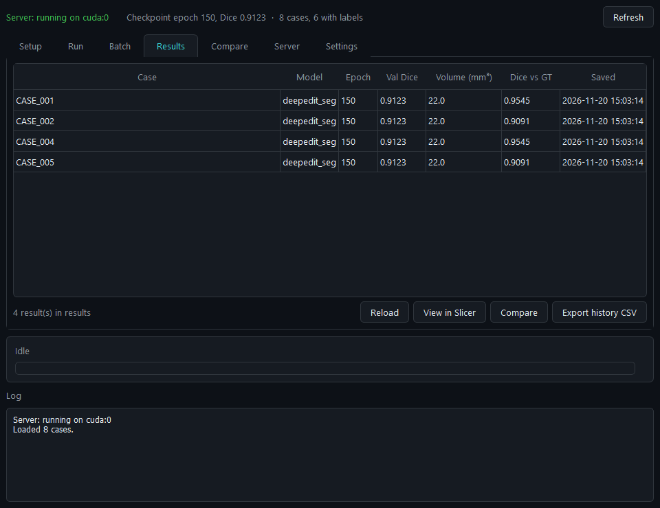
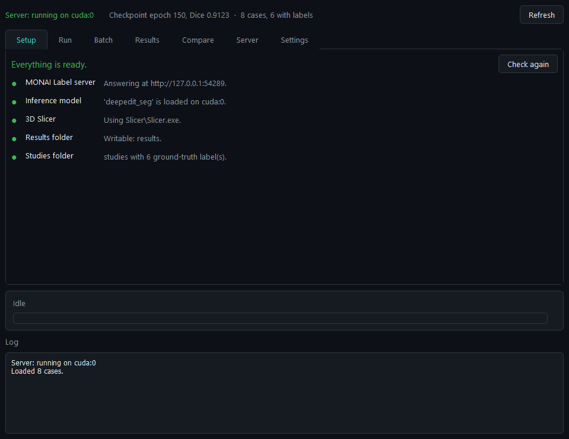

# U-Net Inference Client

A desktop tool for running 3D deep learning segmentation on CT scans, batching it across a
dataset, scoring the results against ground truth, and reviewing them in 3D Slicer.

Built during an ML research internship at Baylor College of Medicine / Texas Children's
Hospital. Running inference there meant activating a virtual environment, starting a
server from the terminal, and chaining shell scripts by hand for every scan. This replaces
that with a GUI that talks to a [MONAI Label](https://github.com/Project-MONAI/MONAILabel)
server, on the same machine or on a GPU workstation across the lab.

**Stack:** Python, PySide6/Qt, MONAI Label, REST, SimpleITK, 3D Slicer

## Quickstart

1. Install. Python 3.10 or newer.

       git clone https://github.com/21Kart28/unet-inference-client.git
       cd unet-inference-client
       python -m venv .venv
       .venv\Scripts\activate        # Windows
       source .venv/bin/activate     # macOS / Linux
       pip install -e .

2. Start it.

       unet-client

3. The first launch opens on the **Setup** tab. Fix anything red: it tells you what is wrong
   and which setting to change. Amber items are optional.

4. Point **Settings** at your MONAI Label server URL and model name, then pick a case on the
   **Run** tab and press Run inference, or tick several on **Batch**.

5. Select a result and press **View in Slicer**, or open **Compare** to score it against the
   ground-truth label.

To try it without a MONAI Label server, run the fake one that ships with the tests in a
second terminal. The app then works end to end with a 4x4x4 toy prediction:

    python tests/mock_server.py --port 8000

With Docker instead, `docker compose up mock-server` builds a small image from
`tests/mock_server.Dockerfile` and serves the same endpoints on port 8000.

## What it does

- **Setup check.** Server reachable, model loaded, 3D Slicer found, results folder writable,
  studies folder present. Each with a one-line fix. Runs again whenever settings change.
- **Single and batch inference.** Pick one case or any subset of the dataset. Live per-case
  and total timers, progress, cancel with resume, and skip-if-already-done. Jobs run on a worker thread
  so the window never freezes.
- **Metrics.** Dice, volume in mm³, volume difference, and 95th-percentile Hausdorff distance
  between a prediction and its ground-truth label, per case or for every result at once.
  Multi-class label maps get a per-label Dice and volume table too.
  Exported to CSV alongside the run history.
- **Model comparison.** The Models tab lines up two models that were run on the same cases
  and shows the Dice delta per case, with a mean and a better/worse count. Try it with
  `python tests/mock_server.py --models deepedit_seg,unet_v2`.
- **Result provenance.** Every prediction is saved with a manifest recording the model,
  checkpoint epoch and validation Dice (read from the server's training stats), SHA-256 of
  the weights, and timestamp. The output folder name carries the epoch and Dice too.
- **Remote servers.** The server check runs off the main thread, and when the scans live on
  the workstation the client downloads a case's source image on demand for Slicer review.
- **3D Slicer viewing.** Opens any prediction over its source scan with surface smoothing
  disabled, so you see the model's actual voxel output rather than a cosmetically smoothed
  surface. Finds the newest Slicer install on its own.
- **Server control.** Start and stop a local MONAI Label server from the app, on Windows or
  Linux, and switch which dataset it serves.

## Requirements

- Python 3.10 or newer
- A MONAI Label server with a trained segmentation model, local or remote
- 3D Slicer for viewing, optional: https://www.slicer.org/

## Development

    pip install -e ".[dev]"
    pytest --cov
    ruff check .
    mypy

`pre-commit install` runs ruff and mypy on each commit, and refuses files over 500 KB so a
scan or label map cannot slip in.

The suite runs against the mock server, so it needs no GPU, model weights or scan data.
It covers the REST client, metrics, Windows and Linux process control, the Slicer launcher,
and the Qt window itself (offscreen).

[docs/architecture.md](docs/architecture.md) has a diagram of the client, the MONAI Label
server, Slicer and the worker threads, and describes what each module owns.

## Windows build

Every `v*` tag builds a Windows folder with PyInstaller and attaches it to a GitHub Release.
To build locally:

    pip install pyinstaller
    pyinstaller unet-client.spec

The app is then `dist/unet-client/unet-client.exe`. It still needs a MONAI Label server and,
for viewing, 3D Slicer; those are not bundled.

## Dataset layout

The MONAI Label datastore expects one volume file per case at the top level of the
studies folder, with ground-truth labels under `labels/final`:

    studies/
      case_001.nrrd
      case_002.nrrd
      labels/
        final/
          case_001.nrrd
          case_002.nrrd

DICOM series folders are not read directly. Convert them to NRRD or NIfTI first.

Settings persist to `~/.config/unet-inference-client/settings.json`.

## Notes

Built and tested against a DynUNet segmentation model served by MONAI Label 0.8.5.
Nothing in the code is specific to one organ or dataset. The model name, server URL,
and all paths are configurable.

## License

MIT
