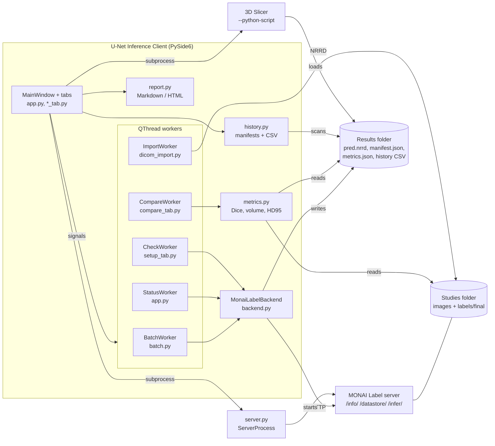

# Architecture

The client is a PySide6 desktop app that talks to a MONAI Label server over HTTP, keeps its
own results folder on disk, and hands finished segmentations to 3D Slicer. Everything slow
runs on a `QThread` so the window stays responsive.



## Pieces

| Piece | Module | Thread | Role |
| --- | --- | --- | --- |
| Main window and tabs | `app.py`, `setup_tab.py`, `compare_tab.py`, `model_compare_tab.py` | GUI | Wires signals; no inference or file scanning of its own. |
| Backend | `backend.py` | caller's | `Backend` interface, a `FakeBackend` for tests, and `MonaiLabelBackend`, which calls `/info/`, `/datastore/` and `/infer/` with `requests`. |
| Batch worker | `batch.py` | QThread | Runs one case after another, emits progress, supports cancel and resume. |
| Compare worker | `compare_tab.py` | QThread | Dice, volume and HD95 per result; per-class rows for multi-label maps. |
| Metrics | `metrics.py` | worker | SimpleITK + NumPy; crops to the union bounding box before HD95 so full scans stay fast. |
| History | `history.py` | GUI | Reads `manifest.json` from each result folder and appends to `inference_history.csv`. |
| Model comparison | `model_compare.py` | GUI | Pairs the newest Dice per case for two models and summarizes the delta. |
| Reports | `report.py` | GUI | Builds one `Report` structure and renders it as Markdown or HTML. |
| DICOM import | `dicom_import.py` | QThread | Finds series with SimpleITK's `ImageSeriesReader` and writes an NRRD into the studies folder. |
| Server process | `server.py` | GUI + reader QThread | Starts and stops a local MONAI Label server and streams its output. |
| Slicer launcher | `slicer_view.py` | subprocess | Writes a small Python script and starts Slicer with `--python-script`. |
| Setup checks | `setup_check.py`, `setup_tab.py` | QThread | Each install check returns OK, optional or problem with a fix hint. |
| Settings | `config.py` | GUI | Dataclass persisted as JSON under the user's config folder. |
| Logging | `logs.py` | any | Rotating file under the config folder; the log pane mirrors into it. |

## Threading rules

- A worker is a `QObject` with signals, moved onto a `QThread`; the thread's `started` signal
  calls `run()`. Results come back through signals, never shared state.
- Workers catch their own exceptions and emit a plain sentence; the GUI never sees a traceback.
- `closeEvent` quits and waits on every thread so the app exits cleanly.

## Data on disk

```
<results>/
  inference_history.csv                one row per attempt
  <case>_<model>_<res>_ep<N>_dice<D>/  one folder per result
    pred.nrrd                          prediction from the server
    manifest.json                      case, model, checkpoint, server, time
    metrics.json                       Dice, volumes, HD95, per-class rows
<studies>/
  <case>.nrrd                        images served by MONAI Label (DICOM imports land here)
  labels/final/<case>.nrrd           ground truth used by the Compare tab
```
